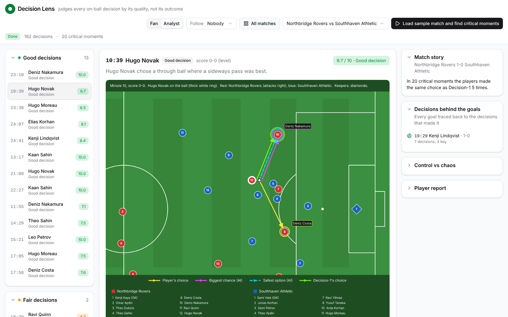
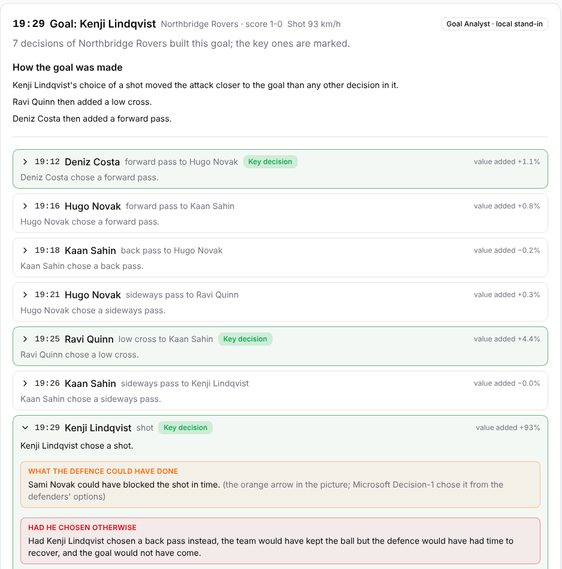
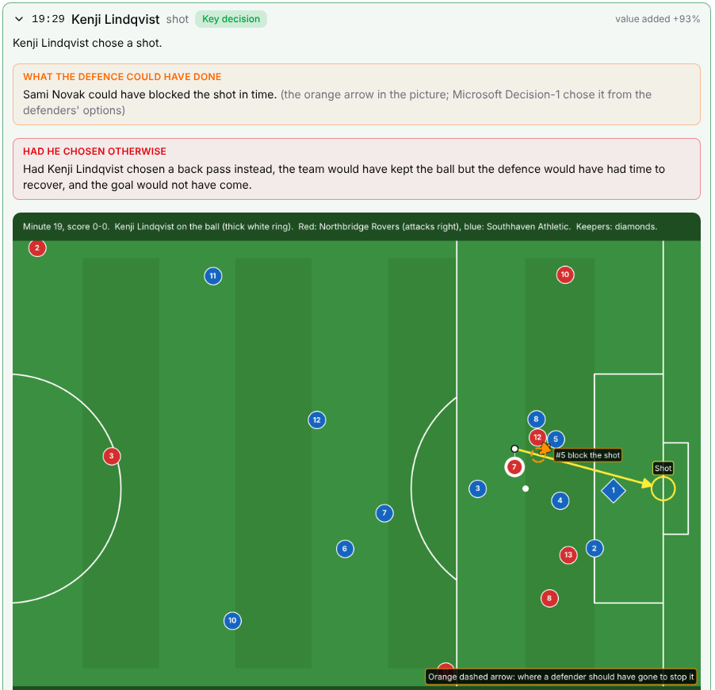
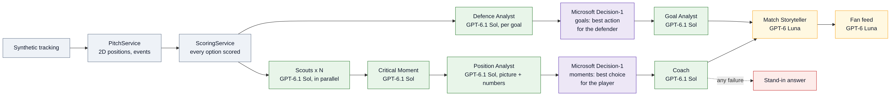

# Decision Lens

**Every goal has a decision behind it.** Decision Lens evaluates every decision players make on the ball, finds the
critical ones that shaped the match, compares each with an AI recommendation from Microsoft Decision-1, and explains
which choice was right and why.

**Live demo:** https://decision-lens-g3hxhha6dtepdzbg.swedencentral-01.azurewebsites.net (no login needed) · **Demo video (under 2 min):** https://youtu.be/xPx0aRWqtR8 ·
**Category:** Best Multi-Agent System

> All match data in this repository is synthetic, made by our own generator (`generator/`). No real player, team,
> match footage or broadcast video is used.



## The idea

A player's most important skill is decision-making, and a match is decided by its critical decisions: behind every
goal there are one or more of them. Yet in club analysis meetings and on TV analysis shows, a decision on the ball is
judged by its result. A pass that led to a goal is praised even when a better option was open, a good choice that
ended in a lost ball is criticised, and the option nobody noticed, the one that could have changed the game, is never
shown.

## What it does

Decision Lens evaluates every decision a player makes on the ball during a match, for example dribbling, shooting,
clearing the ball or passing, and the effect of that decision on the team's situation and on the state of the match.

- **Scores every option.** For each decision, code scores every option the player had in that position.
- **Finds the critical decisions.** AI agents pick the 20-25 decisions that shaped the score.
- **Recommends and compares.** Microsoft Decision-1, a model built for decision-making, recommends the best choice
  for that situation; Decision Lens compares it with what the player did and explains why the player was right or
  what the alternative would have brought.
- **Brings out what was missed.** Options visible on the pitch that nobody took, but that could have changed the game.
- **Explains every goal.** The critical decisions that built it, what another choice would have changed, the
  conceding team's mistakes, and what a defender could have done to stop it.
- **Helps players improve.** Coaches can walk players through their key decisions moment by moment, so
  decision-making improves match after match.

### What you see

1. **Choose a match.** Open an analysed match, or press **Load sample match and find critical moments**.
2. **Critical moments**, grouped by the decision score: Good (7 or more), Fair (4 to 6.9), Poor (under 4).
3. **One moment:** a picture of the pitch from above with arrows, the options with their numbers, Decision-1's choice
   and the Coach's explanation.

   | Arrow | Meaning |
   |---|---|
   | yellow | what the player did |
   | purple | the biggest chance: the option most likely to lead to a goal |
   | cyan, dashed | the safest good option |
   | green | Decision-1's choice |
   | orange | on a goal's pictures: what a defender could have done |

4. **Goals:** the decisions behind each goal and the defence's alternative.
5. **Player report cards:** each player's average decision score, passes, pass completion and length, top speed and
   distance covered.
6. **Match story, Control vs chaos chart and Fan feed:** possession, pressure and turnovers minute by minute, and
   made-up reactions from both sets of fans.
7. **Replay** of any moment in 3D (three.js).
8. **Fan / Analyst** switch and **Follow** a team or a player (see *Personalize* below).

## Goal analysis

Every goal has one or more critical decisions behind it. For each goal Decision Lens goes back through the attack
and explains how it was made and how it could have been stopped:

1. **The chain.** Every decision of the scoring team from winning the ball to the goal, each with the value it added
   (how much closer it brought the goal). The decisions that added most are marked **key decisions**.
2. **Had he chosen otherwise.** For the key decisions, what another option would have changed.
3. **The conceding team's mistakes**, such as how it lost the ball.
4. **What the defence could have done.** At the key decisions, code gives the three nearest defenders their options
   (cut out the pass, mark the receiver goal-side, close the player down, block the shot), each with the chance he
   gets there in time, the goal chance it takes away and the danger he leaves behind if he is late.
   The **Defence Analyst** reads the picture and shortlists them, **Microsoft Decision-1** chooses the defence's best
   action, and the picture shows it as an **orange dashed arrow**.
5. **The Goal Analyst** turns all of this into the goal's story.





## How it maps to the challenge

| Stage | Decision Lens |
|---|---|
| **Ingest** | Synthetic tracking (25 frames per second, every player and the ball) → `PitchService`: 2D positions, on-ball events (pass, shot, dribble, carry, clearance), each player's speed and running direction |
| **Interpret** | `ScoringService`: every option of every decision with the chance it comes off, the goal threat if it works (xT / xG) and the opponent's goal chance if it fails; match stats; Control vs chaos per minute |
| **Explain** | Scouts and Critical Moment agents find the moments; Position Analyst, Decision-1 and Coach explain each one; Defence Analyst and Goal Analyst explain each goal |
| **Render** | Pitch pictures with arrows, 3D replay, and JSON with match times (`ts_ms`, minute, second) for every moment, goal and minute, ready for broadcast overlays |
| **Personalize** | **Fan / Analyst** switch (fans: pictures, Good / Fair / Poor verdicts, the coach's words, goal stories, fan feed; analysts: every option with its numbers, Decision-1's probabilities, the full player table) and **Follow** a team or player (their moments first, the rest faded, their card pinned) |

## Multi-agent design



| Agent | Model | Role | Runs |
|---|---|---|---|
| Scout | GPT-6.1 Sol | reads a stretch of 50 decisions with their numbers, returns up to 10 candidates | one per stretch, in parallel |
| Critical Moment | GPT-6.1 Sol | ranks the candidates and picks the decisions that shaped the match | per 30 candidates, in parallel |
| Position Analyst | GPT-6.1 Sol (picture + text) | reads the pitch picture with every player's position, speed and the options' numbers; names the biggest chance, the safest good option and options the player missed; shortlists for Decision-1 | per moment, in parallel |
| Decision-1, moments | Microsoft Decision-1 (text) | the best choice for the player at each critical moment, aware of minute, score and pitch zone (risk is fine in attack, safety in your own third), with a probability per option | per moment |
| Coach | GPT-6.1 Sol | compares the player's choice with Decision-1's, scores the decision 0-10, explains | per moment |
| Defence Analyst | GPT-6.1 Sol (picture + text) | at a goal's key decisions, shortlists what the three nearest defenders could have done | per key decision |
| Decision-1, goals | Microsoft Decision-1 (text) | the best action for the defender at a goal's key decisions, from the Defence Analyst's shortlist | per key decision |
| Goal Analyst | GPT-6.1 Sol | the decisions behind a goal, the conceding side's mistakes, the defence's alternative | per goal |
| Match Storyteller | GPT-6 Luna | the match story, including when it was under control and when it turned chaotic | once |
| Fan feed | GPT-6 Luna | made-up reactions from both sets of fans | once |

**Why these models.** The analysis agents run on GPT-6.1 Sol because they read a picture of the pitch together with
positions and risk numbers and must judge between options. Decision-1 is a model built for choosing between
options and answers with a probability for each, so it has the last word. The Match Storyteller and Fan feed only
write text from finished results, so they run on the smaller, faster GPT-6 Luna (`FOUNDRY_LIGHT_MODEL`).

**Code computes the numbers, agents decide.** Every probability, xT and xG value comes from code, so every choice an
agent makes can be traced back to data.

- **Distinct roles:** each agent has its own instructions (`backend/src/logic/prompts/`) and its own structured
  output (`backend/src/schemas/agents.py`).
- **Shared state:** the match, its scored decisions and every agent's answer are stored in the database
  (`matches`, `players`, `events`, `moments`); each agent reads what the earlier ones wrote.
- **Handoffs:** Scouts → Critical Moment → Position Analyst → Decision-1 → Coach; Defence Analyst → Decision-1 →
  Goal Analyst; then Match Storyteller → Fan feed.
- **Guardrails:** every percentage or minute an agent writes is checked against the data; a wrong one is sent back
  once, then dropped. Event ids an agent returns must exist.
- **Failure recovery:** when Foundry or Decision-1 is not set up, or a call fails or times out, a local stand-in
  answers that step (marked "local stand-in" on the screen), so one broken call never stops the match.
- **Why more than one agent:** a 30-minute piece has hundreds of decisions with up to 15 options each, and every
  moment needs its own picture. No single agent can read all of it; parallel Scouts and parallel per-moment agents
  can, and each step stays small enough to check.

## Microsoft technology

| Technology | What it does here | Where |
|---|---|---|
| **Microsoft Foundry** | hosts the GPT-6.1 Sol, GPT-6 Luna and Decision-1 deployments | `services/azure_foundry_service.py` |
| **Microsoft Agent Framework** | every agent (`Agent`, `OpenAIChatClient` on the Foundry resource, structured output, image input) | `services/azure_foundry_service.py`, `logic/flow.py`, `logic/prompts/` |
| **Microsoft Decision-1** | the final choice at each moment and the defence's choice at each goal | `services/azure_foundry_service.py`, request built in `core/utils.py` |
| **Azure Blob Storage** | moment pictures and match files | `services/azure_blob_service.py` |
| **Azure Database for PostgreSQL** | the agents' shared state (SQLite locally), Alembic migrations | `db/`, `alembic/` |
| **Azure Monitor / Application Insights** | logs, traces and the agents' own spans via OpenTelemetry, a correlation id per request | `core/observability.py`, `core/telemetry.py` |
| **Azure App Service** (Linux, Python 3.12) | hosts the app: FastAPI serves the API and the built React screen | `backend/src/main.py` |

## Synthetic data

The synthetic matches are made by `generator/generate_match.py`, a match simulator written for this project (how to run it:
[Generate a synthetic match](#2-generate-a-synthetic-match)):

- two teams in real formations (the formation table `generator/shape_table.json`), with a back line that holds its shape, pressing,
  covering runs and runs in behind;
- on-ball decisions chosen from the same kind of options the app scores, so good and poor decisions both happen;
- goals scored from the play, not placed;
- 25 frames per second for 22 players and the ball, written as raw tracking files (one per team), so the same
  pipeline can later read video-derived data;
- reproducible: the same seed gives the same match;
- made-up team and player names.

The demo's sample match is stored in Azure Blob Storage (`sample_match/`); each load analyses a random 30-minute
piece of it. `data/synthetic_match/` holds 15 minutes of the synthetic match SYN-0135, used by the tests.

## How decisions are scored

Each option gets three numbers: the chance it comes off (distance, angle, pressure, defenders near the line), how
likely the attack ends in a goal if it works (an expected threat grid, or xG for a shot), and how likely the opponent
scores from the turnover if it fails. Offside team-mates are left out. The pitch zone matters: in your own third the
safe option is worth more, in the final third a risky one can be right. The Coach scores the player's decision from
0 to 10, guided by how close its expected value is to the best option's; the same choice as Decision-1 scores at
least 7.

## Testing instructions for judges

1. Open https://decision-lens-g3hxhha6dtepdzbg.swedencentral-01.azurewebsites.net/. No login is needed. The demo stays up until judging ends (10 November 2026).
2. Open a match that is already analysed, or press **Load sample match and find critical moments** to analyse a new
   30-minute piece of the sample match (a few minutes; progress is shown).
3. Open a moment: look at the arrows, Decision-1's choice and the Coach's explanation. Then open a goal, the player
   report cards and the replay.
4. Switch **Fan / Analyst** at the top, and **Follow** a team or a player.

## Run it yourself

### 1. The app

Python 3.10 or newer (the Agent Framework needs it). Node 20+ only if you rebuild the screen.

```
cd backend
python3.12 -m venv .venv && source .venv/bin/activate
pip install -r ../requirements.txt
cp .env.example .env
uvicorn src.main:app --reload
```

Open http://localhost:8000. With an empty `.env` the app runs end to end on SQLite and a local folder, and local
stand-ins answer for the agents (marked "local stand-in" on the screen). To use Azure, fill in `backend/.env`:

| Setting | What to put there |
|---|---|
| `FOUNDRY_ENDPOINT`, `FOUNDRY_API_KEY` | the Microsoft Foundry resource's endpoint and key |
| `FOUNDRY_MODEL` | the GPT-6.1 Sol deployment name (all analysis agents) |
| `FOUNDRY_LIGHT_MODEL` | the GPT-6 Luna deployment name (Match Storyteller, Fan feed); empty = `FOUNDRY_MODEL` |
| `DECISION1_ENDPOINT`, `DECISION1_DEPLOYMENT`, `DECISION1_API_KEY` | the Decision-1 deployment |
| `BLOB_CONNECTION_STRING`, `BLOB_CONTAINER` | Azure Blob Storage (empty: files go to a local folder) |
| `DB_CONNECTION_STRING` | `postgresql+psycopg://<user>:<password>@<server>.postgres.database.azure.com:5432/<db>?sslmode=require` (empty: SQLite) |
| `LOGGING_MODE=azure`, `APPLICATIONINSIGHTS_CONNECTION_STRING` | send logs and traces to Application Insights |

With PostgreSQL, create the tables once: `cd backend && alembic revision --autogenerate -m init && alembic upgrade head`.

The screen is already built in `frontend/dist`. To rebuild it: `cd frontend && npm install && npm run build`.

Tests (no Azure needed): `cd backend && python -m pytest -q`.

### 2. Generate a synthetic match

The generator needs only Python 3 (standard library, no packages). One 90-minute match takes about 1-2 minutes.

```
cd generator
python generate_match.py --seed 135 --metrica --out ../output/SYN-0135
```

| Option | |
|---|---|
| `--seed` | the match; the same seed always gives the same match (default 7) |
| `--out` | output folder (default `output`) |
| `--metrica` | also write the raw tracking files the app reads: `SYN-xxxx_RawTrackingData_Home_Team.csv`, `SYN-xxxx_RawTrackingData_Away_Team.csv`, `SYN-xxxx_RawEventsData.csv` |
| `--hz` | frames per second (default 25) |
| `--no-tracking` | skip `tracking.csv.gz` |

Besides the raw tracking files it writes `match_meta.json` (teams, made-up squads), `events.csv`, `freeze_frames.csv`,
`decision_options.csv`, `critical_decisions.csv`, `player_stats.csv`, `player_alerts.csv` and `tracking.csv.gz`.

To make it the demo's sample match, put the two `RawTrackingData` files in the Blob container under `sample_match/`. **Load sample
match and find critical moments** then analyses a random 30-minute piece of it.

`generate_match.py` reads two tables that sit next to it:

- `shape_table.json`: the formation table, where each player stands in open play for each formation and ball position.
- `xt_grid.json`: the expected threat grid, made by `learn_xt.py`. To learn it again from simulated matches:
  `python learn_xt.py --matches 30 --rounds 2` (it plays the matches on every CPU core, measures how often each zone
  leads to a shot and a goal and where the ball moves next, and writes `xt_grid.json`). The backend uses a copy in
  `backend/src/core/xt_grid.json`.

### Deploy to Azure App Service

Create a Linux Python 3.12 web app, deploy this folder (it installs `requirements.txt`), put the `.env` values in
the app's environment variables and set the start command:

```
cd backend && uvicorn src.main:app --host 0.0.0.0 --port 8000
```

## Engineering

- Layers: `api` (routes, no logic) → `logic` (plain functions, the pipeline) → `services` (four classes:
  `AzureFoundryService`, `AzureBlobService`, `PitchService`, `ScoringService`, which never call each other).
- Every request and response is a Pydantic model (`schemas/`); settings come from the environment
  (`pydantic-settings`); no key is ever in the code.
- Logging with a correlation id per request, OpenTelemetry traces to Application Insights.
- Agent output validated against the data before it is stored.
- Tests for pitch reading, scoring and the agent pipeline, run without Azure (stand-in mode).

```
backend/src/
  main.py        FastAPI app: the API router, the screen at /, correlation ids, error handlers
  core/          settings.py, utils.py (constants and pure helpers), xt_grid.json, telemetry.py, observability.py
  db/            database.py, dbUtils.py, models.py (matches, players, events, moments), crud/
  schemas/       scoring.py, agents.py (the agents' answers), views.py (what the routes take and return)
  services/      azure_foundry_service.py, azure_blob_service.py, pitch_service.py, scoring_service.py
  logic/         match.py (load, prepare, replay), flow.py (agents, moments, report), stand_in.py, prompts/
  api/           routes.py (one router) and v1/ (the routes)
backend/alembic/ migrations for PostgreSQL
frontend/        React + TypeScript + Tailwind + shadcn/ui, built with Vite into dist/; src/replay3d.js (three.js)
data/synthetic_match/
                 the synthetic sample used by the tests
generator/       the synthetic match generator
```

## API

| Route | |
|---|---|
| `GET /api/v1/matches`, `GET /api/v1/matches/{id}` | matches and their state |
| `POST /api/v1/matches/sample/analyse` | load a new piece of the sample match and analyse it |
| `POST /api/v1/matches/{id}/flow` | find and explain the critical moments |
| `GET /api/v1/matches/{id}/moments[/{event_id}[/image]]` | the moments, one moment, its picture |
| `GET /api/v1/matches/{id}/goals` | each goal with the decisions behind it |
| `GET /api/v1/matches/{id}/report` | player report cards |
| `GET /api/v1/matches/{id}/rhythm` | control vs chaos, minute by minute |
| `GET /api/v1/matches/{id}/fan-feed` | the made-up fan reactions |
| `GET /api/v1/matches/{id}/replay` | positions frame by frame |

Every answer carries match times, so a broadcast graphics system can turn moments, goals and rhythm into overlays
synchronised with the match feed.

## Responsible AI and limitations

- The numbers are model estimates on synthetic data, not ground truth.
- Decision-1's choice is a suggestion to support a coach or analyst, not a replacement for one.
- Agent sentences are checked against the data; anything that cannot be checked is dropped, and stand-in answers are
  always labelled "local stand-in".
- The Fan feed is clearly made up and written only about made-up team and player names.
- No personal data is collected; there is no login and nothing is tracked beyond technical logs.

## License and credits

- Code: MIT License, see [LICENSE](LICENSE).
- three.js, React, Tailwind CSS, Radix UI, shadcn/ui and mplsoccer (MIT); Lucide icons (ISC).
- 3D player model: "Animated Men" by Quaternius, CC0 1.0 (`frontend/models/LICENSE-player.txt`).
- Expected threat grid: learned by `generator/learn_xt.py` from synthetic matches.
- All data synthetic.
